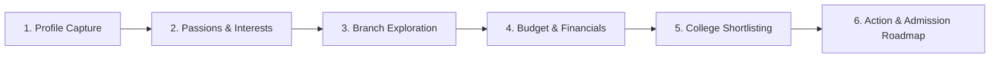

# 🎓 Disha (दिशा) — AI Engineering Pathway Guide

<div align="center">


### *AI-Enabled Family Decision-Support Platform for Engineering Admissions in India*

[](https://react.dev/)
[](https://tanstack.com/start)
[](https://www.typescriptlang.org/)
[](https://tailwindcss.com/)
[](https://sdk.vercel.ai/)
[](https://lovable.dev)
[](LICENSE)

[**Live Demo / Lovable Editor**](https://lovable.dev/projects/6bdabedd-92fd-4dc3-80d3-e3fd52858bbf) • [**Architecture**](#-architecture) • [**6-Stage Journey**](#-the-6-stage-decision-journey) • [**Tech Stack**](#-tech-stack) • [**Getting Started**](#-getting-started)

</div>

---

## 📖 Overview

Deciding on an engineering pathway in India is one of the highest-stakes, most overwhelming life milestones for students and their families. With over a hundred branch specializations, dozens of entrance exams (JEE Main, JEE Advanced, BITSAT, State CETs), multi-round counselling systems (JoSAA, CSAB, state quotas), and complex fee structures, families often struggle with conflicting opinions, lack of structured data, and high anxiety.

**Disha (दिशा)** is an empathetic, proactive, and intelligent AI education counsellor designed to sit with the student and parents *together*. Through a single, seamless, continuous voice and chat session, Disha listens to academic profiles, surfaces student passions, respects parental concerns regarding budget and ROI, and maps out a transparent, data-backed admission roadmap.

---

## ✨ Key Highlights

- 🎙️ **Continuous Multimodal Voice + Chat**: Speak naturally or type in real time. Features bidirectional Web Speech voice input and conversational text-to-speech narration with zero session resets.
- 🇮🇳 **Culturally Fluent & Bilingual**: Full conversational support for both **English** and **हिन्दी (Hindi / Hinglish)**, speaking comfortably to both tech-savvy students and traditional parents.
- 🧭 **Proactive 6-Stage Counselling Pathway**: Rather than waiting for prompts, Disha dynamically guides families through a structured consultation flow from profile capture to actionable checklists.
- ⚡ **Tap-to-Answer Interactive Suggestions**: Automatically extracts contextual, clickable suggestion pills (`OPTIONS: ...`) for fast and intuitive input on mobile or desktop.
- 💰 **Comprehensive 4-Year INR Financial Planning**: Provides realistic fee ranges for tuition, hostels, and living expenses, factoring in NSP scholarships, tuition fee waivers (TFW), and Vidya Lakshmi education loans.
- 🏛️ **Pan-India Admission & Cut-Off Insights**: Covers IITs, NITs, IIITs, BITS, CFTIs, state government institutions, and top private universities with home-state quota and category nuances.

---

## 🗺️ The 6-Stage Decision Journey



| Stage | Focus Area | What Disha Uncovers & Guides |
|:---:|:---|:---|
| **1** | **Academic Profile** | Student's current class (10th/12th/dropper), board marks, expected or actual JEE/CET rank or percentile, home state domicile, and category quotas (General, OBC-NCL, EWS, SC/ST). |
| **2** | **Interests & Passions** | Core subjects enjoyed (Maths, Physics, Coding, Robotics, Design), personal strengths, career dreams, and respectfully mediating student vs. parent differences. |
| **3** | **Branch Discovery** | Personalized recommendations across CSE, AI/DS, ECE, EEE, Mechanical, Aerospace, Biotech, etc., highlighting modern curriculum and industry hiring trends. |
| **4** | **Financial & Budgeting Plan** | Realistic 4-year INR expense modeling (tuition, hostel, living costs), central/state fee waivers, merit scholarships, and bank education loan schemes. |
| **5** | **College Shortlisting** | Three-tier recommendations: **Safe** (high probability), **Moderate** (competitive match), and **Ambitious** (stretch goals) tailored to cut-offs and location preferences. |
| **6** | **Admission Action Roadmap** | Timelines for exams (JEE, BITSAT, CETs), counselling schedules (JoSAA, CSAB, State portals), document checklists, and proactive next steps. |

---

## 🏗️ Architecture

```
┌────────────────────────────────────────────────────────┐
│                   User / Family                        │
│          (Voice Input & Audio Playback / Chat)          │
└───────────────────────────▲────────────────────────────┘
                            │
                            ▼
┌────────────────────────────────────────────────────────┐
│            Frontend (TanStack Start + React 19)        │
│  • Web Speech Audio Pipeline (useVoice hook)           │
│  • Continuous Conversation Engine (useChat transport)  │
│  • Reactive Stage & Action Pill Parser (parseReply)    │
│  • Radix UI + Tailwind CSS v4 Component System         │
└───────────────────────────▲────────────────────────────┘
                            │
                            ▼  POST /api/chat (SSE Stream)
┌────────────────────────────────────────────────────────┐
│           TanStack Start API Route & Server            │
│  • src/routes/api/chat.ts                              │
│  • Nitro Server Engine (H3 error boundary normalization)│
│  • Server-Side AI Orchestration (src/lib/ai)           │
└───────────────────────────▲────────────────────────────┘
                            │
                            ▼  Stream via Lovable Gateway
┌────────────────────────────────────────────────────────┐
│           Lovable AI Gateway / LLM Engine              │
│  • Model: openai/gpt-6-astra                           │
│  • System Prompt: Disha Indian Engineering Counsellor  │
└────────────────────────────────────────────────────────┘
```

---

## 🛠️ Tech Stack

### Core Framework & Runtime
- **[TanStack Start](https://tanstack.com/start)** — Full-stack React framework powered by TanStack Router and Nitro engine.
- **[React 19](https://react.dev/)** — Modern component architecture and concurrent rendering.
- **[TypeScript 5.8](https://www.typescriptlang.org/)** — Full end-to-end type safety.
- **[Vite 8](https://vite.dev/)** — Next-generation frontend build tooling and rapid HMR.

### AI & Streaming
- **[Vercel AI SDK](https://sdk.vercel.ai/)** (`ai`, `@ai-sdk/react`) — Unified streaming chat primitives.
- **[Lovable AI Gateway](https://lovable.dev)** — High-performance AI gateway running advanced models (`gpt-6-astra`).
- **[Streamdown](https://github.com/)** — Fast, flicker-free markdown streaming and rendering.

### User Interface & Styling
- **[Tailwind CSS v4](https://tailwindcss.com/)** — Cutting-edge utility-first CSS engine.
- **[Radix UI](https://www.radix-ui.com/)** — Accessible, unstyled UI primitives (dialogs, tooltips, accordions, dropdowns).
- **[Lucide React](https://lucide.dev/)** — Crisp, consistent icon library.
- **[Sonner](https://sonner.emilkowal.ski/)** — Smooth, modern toast notifications.

---

## 📁 Project Structure

```bash
engineering-pathway-guide/
├── public/                 # Static web assets & brand media
│   ├── disha-logo.png      # High-resolution Disha application brand logo
│   └── favicon.png         # Browser favicon
├── src/
│   ├── assets/             # Bundled image assets
│   ├── components/         # Reusable UI component library
│   │   ├── ai-elements/    # AI chat conversation, message bubbles & prompt inputs
│   │   └── ui/             # Radix-based UI components (buttons, cards, dialogs)
│   ├── hooks/              # Custom React hooks (useVoice for speech-to-text/TTS)
│   ├── lib/                # Shared utilities & AI service layer
│   │   ├── ai/             # Server-side AI prompt templates, streaming responses
│   │   │   ├── chat.server.ts # Disha core system prompt & handler
│   │   │   └── responses.ts   # Gateway connection logic
│   │   ├── error-capture.ts   # Resilient error capture
│   │   └── utils.ts           # Class merge & formatting utilities
│   ├── routes/             # TanStack Router file-based routing
│   │   ├── __root.tsx      # Root application layout & document shell
│   │   ├── index.tsx       # Main interactive counselling dashboard
│   │   └── api/
│   │       └── chat.ts     # POST API route handler for AI streaming
│   ├── server.ts           # Nitro server entry & SSR normalization
│   ├── start.ts            # TanStack Start router bootstrap
│   └── styles.css          # Global styles & Tailwind CSS v4 directives
├── package.json            # Project dependencies and script declarations
├── vite.config.ts          # Vite configuration with TanStack Start plugin
└── tsconfig.json           # TypeScript configuration
```

---

## 🚀 Getting Started

### Prerequisites

- **Node.js**: Version 20.x or higher (recommended: LTS via [nvm](https://github.com/nvm-sh/nvm))
- **Package Manager**: `npm` (or `bun` / `pnpm`)

### 1. Clone the Repository

```bash
git clone https://github.com/Jarvis-os-tech/engineering-pathway-guide.git
cd engineering-pathway-guide
```

### 2. Install Dependencies

```bash
npm install
# or if you use bun:
bun install
```

### 3. Configure Environment Variables

Copy the example environment file:

```bash
cp .env.example .env
```

Open `.env` and set your preferred AI API key:

```env
# Google Gemini (Recommended - get key at https://aistudio.google.com/app/apikey)
GEMINI_API_KEY=AIzaSy...
GEMINI_MODEL=gemini-2.5-flash

# OR OpenAI (get key at https://platform.openai.com/api-keys)
# OPENAI_API_KEY=sk-...
# OPENAI_MODEL=gpt-4o

# OR Lovable (automatically provisioned when developing inside Lovable editor)
# LOVABLE_API_KEY=your_lovable_api_key_here
```

#### 🌐 Deploying on Vercel:
1. Go to your project dashboard on [Vercel](https://vercel.com) -> **Settings** -> **Environment Variables**.
2. Add `GEMINI_API_KEY` (or `NEXT_PUBLIC_API_KEY` / `OPENAI_API_KEY`) with your key.
3. Select **Production**, **Preview**, and **Development**.
4. Trigger a **Redeploy** (Deployments -> latest deployment -> Redeploy).

### 4. Start Development Server

```bash
npm run dev
```

Open [http://localhost:3000](http://localhost:3000) (or the port indicated in your console) to begin your interactive counselling session.

---

## 🧪 Available Scripts

| Command | Description |
|:---|:---|
| `npm run dev` | Starts the local development server with Vite HMR |
| `npm run build` | Builds the client and server application for production |
| `npm run preview` | Previews the production build locally |
| `npm run test` | Runs the test suite via Vitest |
| `npm run lint` | Runs ESLint to check for code quality and style |
| `npm run format` | Auto-formats code with Prettier |

---

## 🤝 Lovable Integration

This project is continuously connected to **[Lovable](https://lovable.dev)**:

- **Two-Way Synchronization**: Every commit pushed to the `main` branch syncs seamlessly back into the Lovable visual editor.
- **Visual Editing**: Edit components, adjust styling, and refine AI behavior collaboratively in the browser or locally in your favorite IDE.
- **Zero Lock-in**: Full ownership of all source code, dependencies, and deployment targets.

---

## 📜 License

This project is licensed under the [MIT License](LICENSE) — feel free to use, modify, and distribute for personal or educational initiatives.

<div align="center">
<sub>Crafted with ❤️ for students and parents navigating the future of engineering.</sub>
</div>
